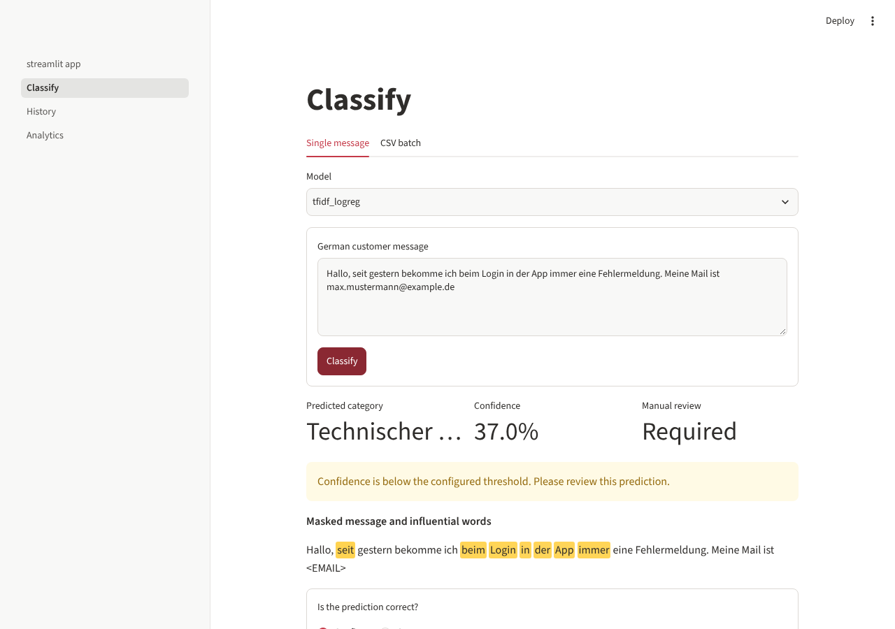

# German Customer Request Classification

Classifies German customer messages (Rechnung, Technischer Support, Adressänderung, Kündigung) with TF-IDF + logistic regression or an optional DistilBERT model. Predictions are PII-masked, stored in PostgreSQL and shown in a Streamlit app.



## Quick start

```bash
pip install -r requirements.txt
python -m scripts.train --model baseline
python -m scripts.evaluate
streamlit run streamlit_app.py
pytest -q
```

## Status

Early prototype. On a 120-message hand-written test set the baseline reaches about 49% accuracy (see `reports/results.md`), because the training data has too few Adressänderung and Kündigung examples. Names and addresses are not masked.

See [MODEL_CARD.md](MODEL_CARD.md) and [DATA_SOURCES.md](DATA_SOURCES.md) for details and licenses. Code is under the [MIT License](LICENSE).
